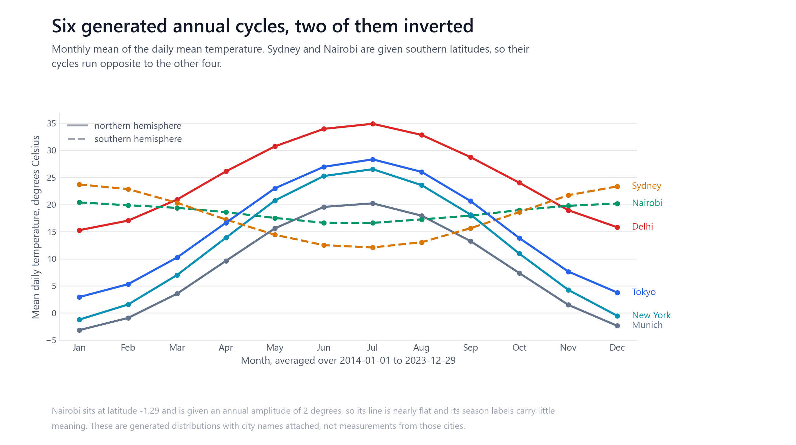
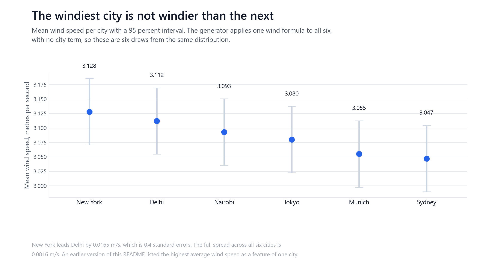
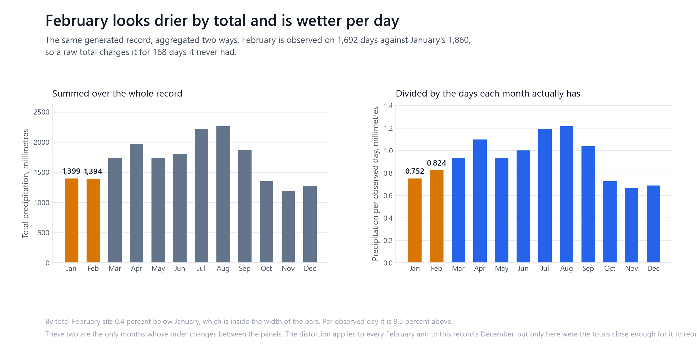
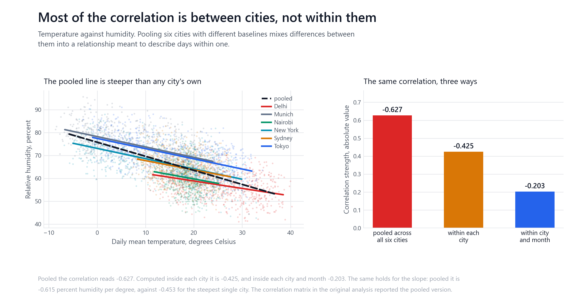

# Weather data analysis, and three ways a summary can mislead

<!-- project-story:start -->
<p align="center"></p>

| Problem | Why it mattered | Result |
|---|---|---|
| Charts of synthetic data look like findings. | The fair test is recovering what was planted. | **0.09 °C** largest temperature gap from the generator, across six cities |

[See it animated on mzquadri.de](https://mzquadri.de/work/weather-eda)
<!-- project-story:end -->

An exploratory analysis of a generated ten-year daily weather record for six
cities. No model is fitted and none is needed: the work is in the acquisition,
the aggregation and the reading of the result.

The dataset is produced by `src/generate_data.py` with a fixed seed. It is not
station data and carries no climate information. What makes it worth analysing
carefully is that three of the statements the repository originally published do
not survive being checked, and each fails in a way that is easy to reproduce on
real data.

A ranking that is sampling noise. A monthly comparison across months of different
lengths. A correlation that mostly measures the difference between cities rather
than anything inside one.



## What this analysis studies

Four questions, each answerable from the record alone:

1. What does the annual cycle look like in each city, and does the southern
   hemisphere behave as it should?
2. Which months are wet, and does the answer depend on how the months are
   aggregated?
3. Is the windiest city actually windier than the next?
4. How much of the temperature and humidity relationship survives once cities and
   seasons are separated?

## Data source and coverage

Generated by `src/generate_data.py`, seed 42. No download, no API, no credentials,
and no relationship to any weather service. The city names, latitudes and units
are chosen to make the record legible; the values are drawn from parameterised
distributions.

| | |
| --- | --- |
| Rows | 21,900 |
| Cities | 6 |
| Columns | 15 |
| Distinct days | 3,650 |
| First date | 2014-01-01 |
| Last date | 2023-12-29 |

**The record is not ten calendar years.** The generator asks for `n_years * 365`
days, which ignores leap days, so ten years starting on 1 January 2014 runs out
on 2023-12-29. 2023 is short by 2 days. The README previously described the range
as 2014-2023, which reads as ten complete years.

### Schema

Nine measurements per city per day. All numeric, none missing, none derived.

| Column | Meaning | Unit | Aggregates by |
| --- | --- | --- | --- |
| temp_mean_c | daily mean temperature | degrees Celsius | mean |
| temp_max_c | daily maximum temperature | degrees Celsius | mean |
| temp_min_c | daily minimum temperature | degrees Celsius | mean |
| precipitation_mm | daily precipitation | millimetres | sum |
| humidity_pct | relative humidity | percent | mean |
| wind_speed_ms | wind speed | metres per second | mean |
| pressure_hpa | air pressure | hectopascals | mean |
| cloud_cover_pct | cloud cover | percent | mean |
| uv_index | UV index | index, 0 to 12 | mean |

Alongside these the record carries `date`, `city`, `latitude`, `month`, `year` and
`season`.

### Time handling

Dates are calendar days with no time component and no timezone, so there is no
UTC-against-local question and no daylight-saving boundary to cross. Daily values
are generated directly rather than aggregated from hourly readings, so no
aggregation boundary is being chosen on the reader's behalf.

## Data quality

| Check | Result |
| --- | --- |
| Missing values | 0 |
| Duplicate city and date pairs | 0 |
| Largest gap between consecutive days | 1 day |
| Years short of a full calendar year | 2023, by 2 days |

No interpolation is performed anywhere, and none is needed.

Two generator artifacts are worth knowing before reading any figure built on
them.

**The UV index has a hard floor.** The generator clips a sine wave at zero, so UV
sits at or below 0.05 for between 27.4 and 29.1 percent of days in every city.
Real winter UV outside the tropics is low but not absent, so a UV figure from this
record describes the clipping rather than a season.

**Nairobi is given southern-hemisphere season labels at latitude -1.29.** That is
consistent with the sign of its latitude, but a city on the equator has no
meaningful thermal winter, and this one is given an annual amplitude of 2 degrees.
The labels are a convention here rather than a description.

## The cities

| City | Latitude | Hemisphere | Mean temp, C | SD, C | Coldest, C | Hottest, C | Precip per year, mm | Dry days |
| --- | --- | --- | --- | --- | --- | --- | --- | --- |
| Delhi | 28.61 | northern | 24.98 | 7.47 | 2.9 | 48.9 | 366.3 | 72.0% |
| Munich | 48.14 | northern | 8.56 | 8.83 | -16.8 | 35.0 | 330.5 | 70.9% |
| Nairobi | -1.29 | southern | 18.59 | 2.81 | 2.1 | 34.6 | 207.4 | 71.5% |
| New York | 40.71 | northern | 12.57 | 10.28 | -16.8 | 40.0 | 353.8 | 70.2% |
| Sydney | -33.87 | southern | 17.93 | 4.92 | -2.6 | 36.4 | 316.0 | 69.6% |
| Tokyo | 35.68 | northern | 15.50 | 9.50 | -11.9 | 41.5 | 447.5 | 69.5% |

Delhi is the warmest and Munich the coolest, both by a wide margin and both
because the generator was configured that way. Tokyo receives the most
precipitation, again by configuration. Nairobi varies least, with a standard
deviation of 2.81 against Munich's 8.83.

## Finding 1: the windiest city is not windier



The repository listed "highest average wind speed" as a feature of New York, in
the same table as Delhi's monsoon and Sydney's reversed seasons, which are
configured properties.

Wind is not configured per city. The generator applies one formula to all six,
varying only the seasonal phase. New York leads Delhi by **0.0165 m/s, which is
0.40 standard errors**, and the full spread across all six cities is 0.0816 m/s.
Every interval in the figure overlaps every other one.

This is the failure mode worth taking from the repository: a ranking computed over
six equivalent groups will always produce a winner, and reporting that winner as a
characteristic turns noise into a finding.

## Finding 2: a shorter month is not a drier month



Monthly precipitation was summed across the whole record and compared month to
month. Months are not the same length, so the comparison is not like for like.
Across ten years February is observed on **1,692 days** against January's
**1,860**, so a raw total charges February for 168 days it never had.

February totals **1,393.6 mm** against January's **1,398.7 mm**, which reads as
the drier month. Per observed day, February is the wetter one, **0.824 mm**
against **0.752 mm**. The gap between the two readings is the size of the effect:
by total February sits **-0.4 percent** relative to January, and per observed day
**9.5 percent** above it.

The distortion is systematic but its reach here is small. Only **January and February**
change position between the two orderings, because the other months are far
enough apart in total that a three-day correction does not reorder them. August
is wettest and November driest on both measures. The point is not that the
ranking collapses; it is that a 9.5 percent difference was reported as a 0.4
percent one, with the sign reversed.

## Finding 3: the correlation is mostly between cities



The correlation matrix was computed over all six cities pooled together. Delhi is
hot and relatively dry, Munich is cool and humid, and pooling them puts that
contrast into a coefficient that is meant to describe how one city's humidity
moves with its own temperature.

Temperature against humidity, at three levels:

| Computed | Correlation |
| --- | --- |
| Pooled across all six cities | -0.627 |
| Within each city, averaged | -0.425 |
| Within each city and month, averaged | -0.203 |

The pooled figure is about three times the within-city-and-month one. The same
pattern holds for temperature against pressure: -0.49 pooled, -0.397 within city,
-0.158 within city and month.

The regression slope says the same thing in the units of the data. Pooled, the
line falls **-0.615** percent humidity per degree. No single city is that steep:
the steepest is **-0.453** and the shallowest **-0.324**. The pooled line is not
an average of the six, it is a line drawn through six clusters that sit at
different heights, which is visible in the left panel above.

None of these is evidence of causation, and the direction is a generator setting
rather than a physical result.

## Extremes

Selected by rule from the record rather than chosen by eye.

| | City | Date | Value |
| --- | --- | --- | --- |
| Hottest day | Delhi | 2016-06-24 | 48.9 C |
| Coldest day | Munich | 2022-01-26 | -16.8 C |
| Wettest day | Sydney | 2014-11-04 | 104.0 mm |
| Windiest day | Nairobi | 2022-07-29 | 13.0 m/s |
| Longest dry run | Munich | | 37 days |

The wettest day comes from the generator's deliberate extreme-event injection,
which multiplies 0.3 percent of rainfall values by between 5 and 12. It is
extreme by construction rather than by accident. The windiest day has no such
mechanism behind it: wind is a Weibull draw scaled by a seasonal term and clipped
at 25 m/s, so 13.0 m/s is simply the largest value in 21,900 draws.

The longest dry run is a property of independent daily draws rather than of a
weather pattern. The generator has no persistence, so a 37-day run here is what a
sequence of coin flips at Munich's dry-day rate produces, not a drought.

## Reproducing

```bash
pip install -r requirements.txt

python -m src.generate_data                  # writes data/weather_data.csv
python -m src.summary                        # writes results/summary.json
python src/eda_analysis.py                   # the original twelve figures
python scripts/figures/generate_figures.py   # the four figures above
python -m unittest discover -s tests
python scripts/check_repository.py           # README against results/summary.json
```

Every number in this README is read from `results/summary.json`, and
`scripts/check_repository.py` fails if the two stop agreeing.

## Limitations

The dataset is generated. Every value describes `src/generate_data.py` and
nothing else. The city names carry no information about those cities, and no
statement here is evidence about weather or climate anywhere.

Ten years is too short a window to support a trend claim even on real data, and
this record is synthetic besides. Where the analysis mentions change over time it
means change within this generated record.

The generator draws each day independently around a seasonal mean, so there is no
day-to-day persistence: real weather is autocorrelated and this is not. Any
analysis of spells, runs or transitions would behave differently on real data, and
the dry-run figure above should be read with that in mind.

The UV clipping and the equatorial season labels described under Data quality
affect any figure built on those columns.

The record is small enough that none of this needs an accelerator: it is under
5 MB once parsed, regenerating it takes about half a second and the grouped
correlations take single-digit milliseconds. No GPU-capable library is in the
dependency list and none is warranted.

The committed figures were rendered by a specific matplotlib, which writes its
version into every PNG. `scripts/check_repository.py` compares those versions and
fails if the sixteen figures are not one vintage, which is what catches a set
regenerated on its own. It does not compare pixels: matplotlib renders
differently between releases, so a figure regenerated under a newer version will
not be byte-identical to the committed one even when the analysis behind it has
not moved.

## Provenance

The repository previously published `results/key_findings.json` and twelve
figures. Those artifacts are kept. What changed is which statements the README
makes from them.

| Claim | Status |
| --- | --- |
| Delhi is the hottest generated city | holds, and is configured |
| Munich is the coldest generated city | holds, and is configured |
| Tokyo has the highest total precipitation | holds, and is configured |
| Delhi has a July to September precipitation spike | holds, and is configured |
| Sydney has reversed seasons | holds, and is configured |
| Nairobi has limited temperature seasonality | holds, and is configured |
| New York has the highest average wind speed | technically true of the sample, but 0.40 standard errors and not configured; removed as a city feature |
| Ten years, 2014 to 2023 | the record ends 2023-12-29 and 2023 is 2 days short |

`src/eda_analysis.py` and its twelve figures are unchanged in what they compute.
The correlation matrix it produces is the pooled one, which is why the pooling
comparison above exists rather than a replacement of that figure. Two labels on
figure 08 were reworded: it plots a departure from each city's own monthly mean,
which the previous title called a climatology anomaly. The generator draws days
independently, so that series has no trend in it to find.

## Checks

`.github/workflows/repository-check.yml` runs on every push. It lints, rebuilds
the record from the seed, runs the tests, verifies the README against
`results/summary.json` and regenerates the four figures.

The tests are analytical rather than decorative. They cover the schema and unit
ranges, the leap-day shortfall, the hemisphere labels against the temperature
they mark, the totals-against-rates distinction, the three levels of correlation
pooling, the wind lead measured in standard errors, and the rule behind each
extreme. They also rebuild the summary in memory and compare it section by
section against the committed `results/summary.json`, so a change in the analysis
that is not reflected in the artifact fails.

## Licence

MIT. See [LICENSE](LICENSE).
