# Weather Data Analytics - Synthetic Exploratory Data Analysis

An exploratory-data-analysis demonstration using deterministic, generated daily weather observations for six cities. It demonstrates data wrangling, statistical summaries, and visualization techniques with Python.

> **Synthetic-data demonstration:** The dataset, findings, and figures are produced by `src/generate_data.py` with a fixed seed. They are not weather-station observations, climate evidence, forecasts, or a basis for operational, scientific, or policy decisions.

## Dataset

Synthetic 10-year daily weather data (2014-2023) for six cities:

| City | Climate Zone | Avg Temp (°C) | Key Feature |
|------|-------------|---------------|-------------|
| Munich | Temperate Continental | ~8.5 | Cold winters, warm summers |
| Delhi | Subtropical | ~25.0 | Monsoon precipitation pattern |
| Tokyo | Humid Subtropical | ~15.5 | Highest total precipitation |
| New York | Humid Continental | ~12.5 | Highest average wind speed |
| Sydney | Oceanic | ~18.0 | Reversed seasons (Southern Hemisphere) |
| Nairobi | Tropical Highland | ~18.5 | Minimal temperature variation |

**Features**: Temperature (mean/max/min), precipitation, humidity, wind speed, pressure, cloud cover, UV index

**Total records**: 21,900 (6 cities x 3,650 days)

The generator encodes illustrative seasonal, precipitation, and variable-correlation patterns. City-level differences and conclusions below therefore describe the generator's configured distributions, not measured city climates. Seasons respect each city's hemisphere.

## Reference Visualizations

### Temperature Distributions

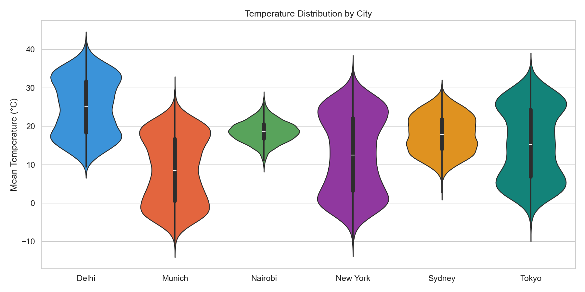

### Monthly Temperature Heatmap

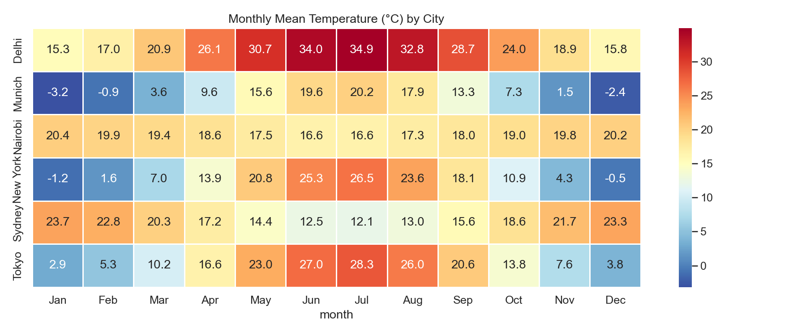

### Seasonal Temperature Comparison

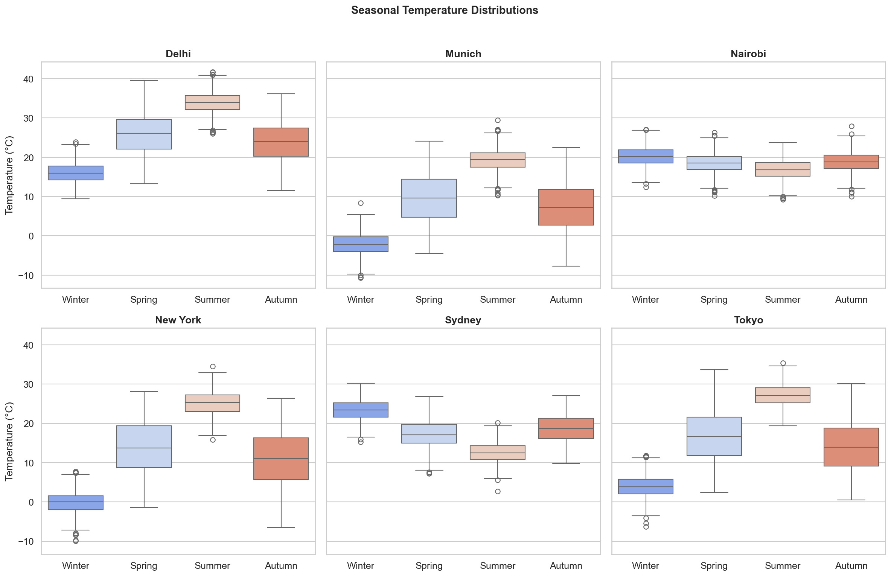

### Monthly Precipitation Patterns

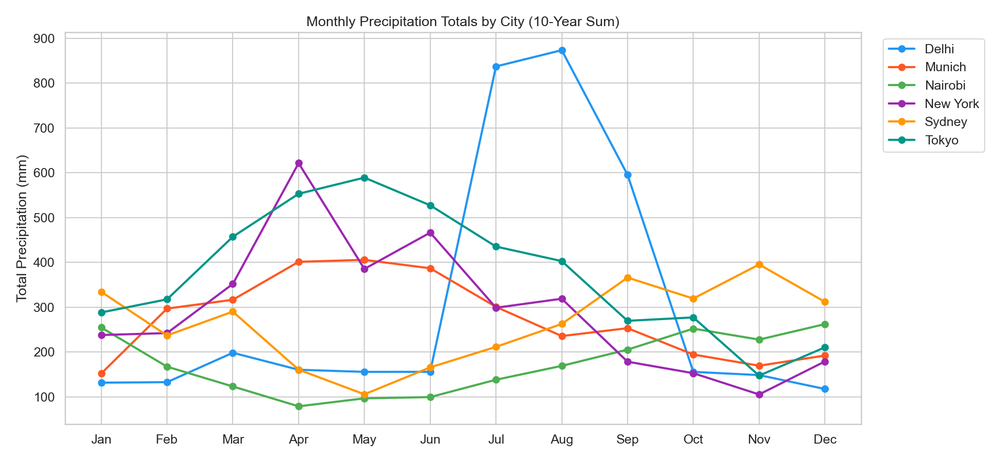

### Diurnal Temperature Range

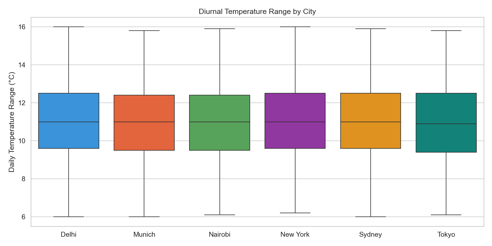

### Feature Correlation Matrix

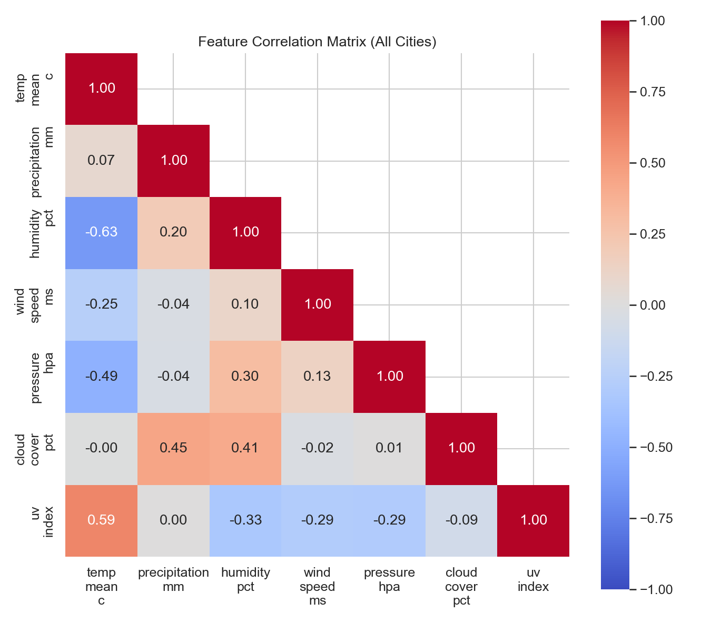

### Wind Speed Distributions

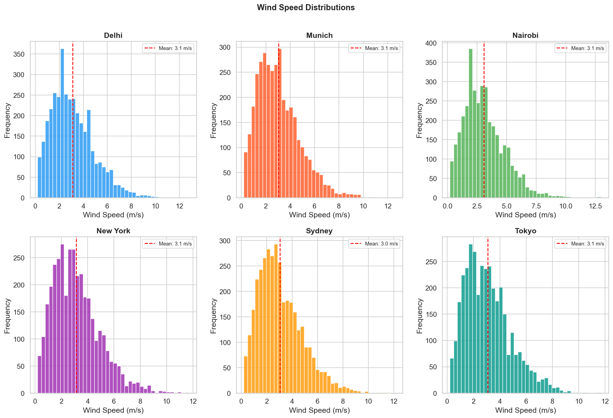

### Temperature Anomaly Trends

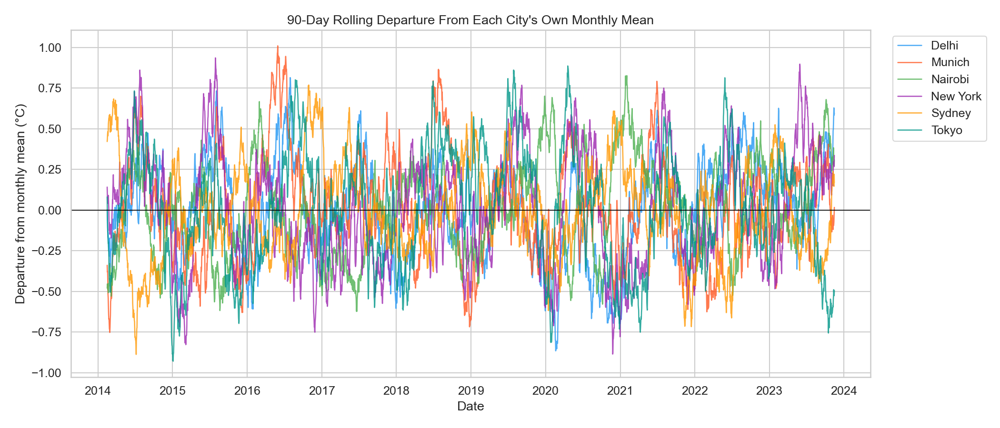

### Precipitation Exceedance Curves

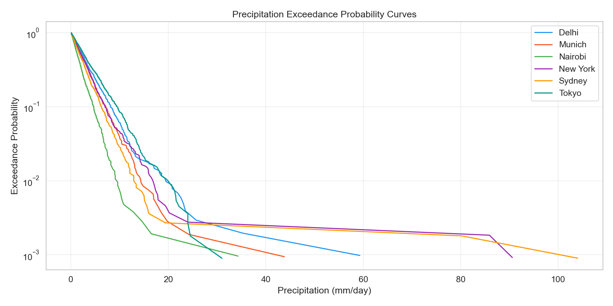

### Temperature vs Humidity

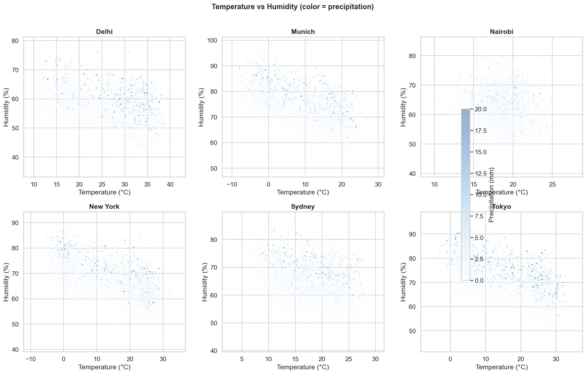

### UV Index Seasonal Patterns

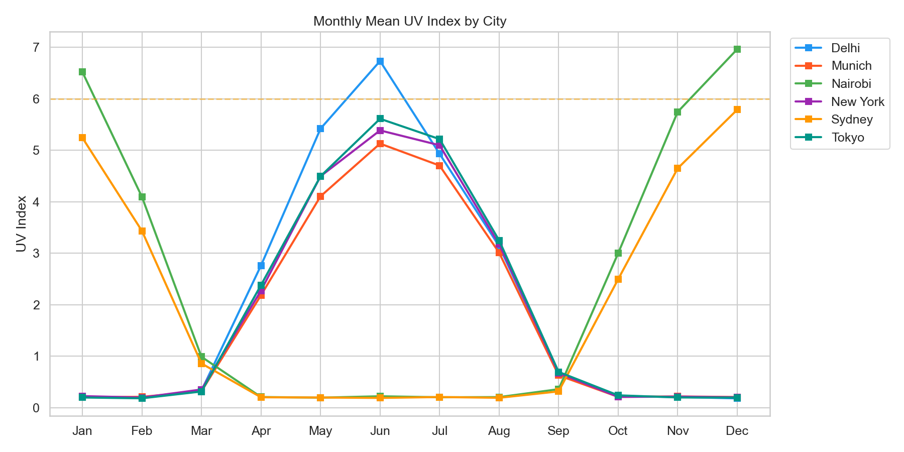

### Pairwise Feature Relationships

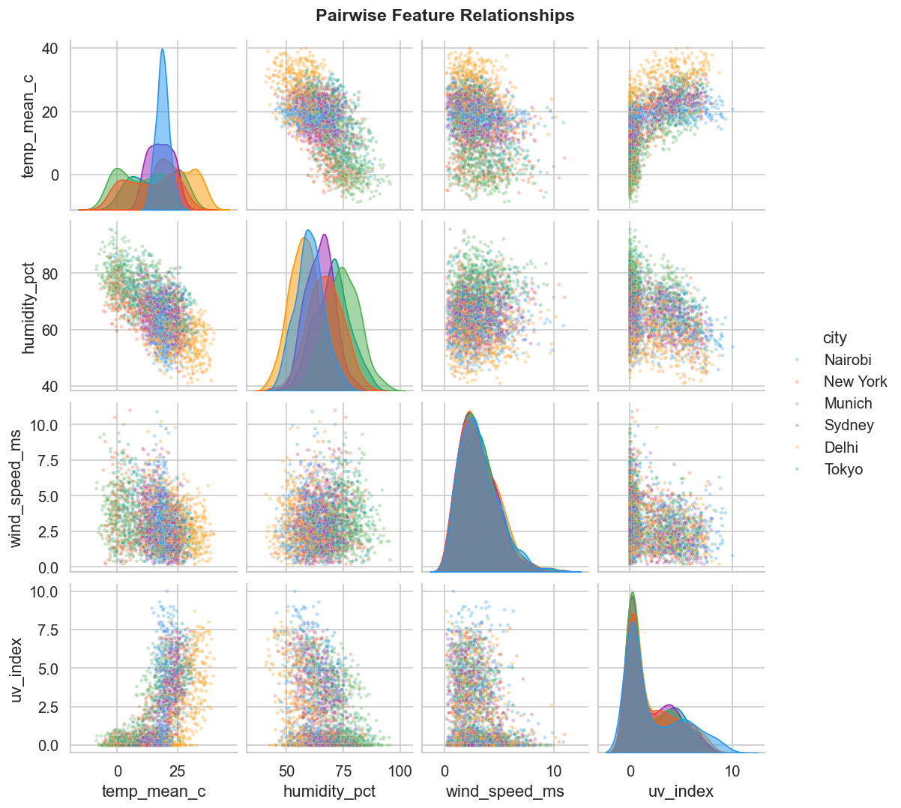

## Project Structure

```
.
├── src/
│   ├── generate_data.py     # Synthetic weather data generation
│   └── eda_analysis.py      # Full EDA pipeline (12 visualizations)
├── data/
│   └── weather_data.csv     (generated, not tracked)
├── results/
│   ├── figures/             # 12 publication-quality plots
│   ├── key_findings.json    # Automated key findings
│   └── city_summary_statistics.csv
├── requirements.txt
└── README.md
```

## Generated Reference Findings

- **Hottest generated city**: Delhi (mean ~25 C)
- **Coldest generated city**: Munich (mean ~8.5 C)
- **Wettest generated city**: Tokyo (highest generated total precipitation)
- **Windiest generated city**: New York (highest generated mean wind speed)
- **Configured Delhi pattern**: a precipitation spike in July-September
- **Configured Southern Hemisphere pattern**: Sydney has reversed temperature seasons
- **Configured Nairobi pattern**: limited temperature seasonality
- The generated variables include negative temperature-pressure and positive cloud-cover-humidity relationships

These statements only summarize the included reference run. Re-run the pipeline after changing the generator or dependency versions; do not interpret them as empirical climate findings.

## How to Run

```bash
pip install -r requirements.txt
python src/generate_data.py
python src/eda_analysis.py
python scripts/check_repository.py
```

The first command creates the untracked `data/weather_data.csv`; the second overwrites the tracked reference artifacts in `results/`. The included artifacts were generated with the default 10-year, seed-42 configuration. Review output changes before committing them.

## Tech Stack

- **pandas** — Data manipulation and aggregation
- **matplotlib** — Base plotting library
- **seaborn** — Statistical visualizations
- **NumPy** — Numerical computations
- **SciPy** — Statistical functions

## License

This project is released under the [MIT License](LICENSE).
